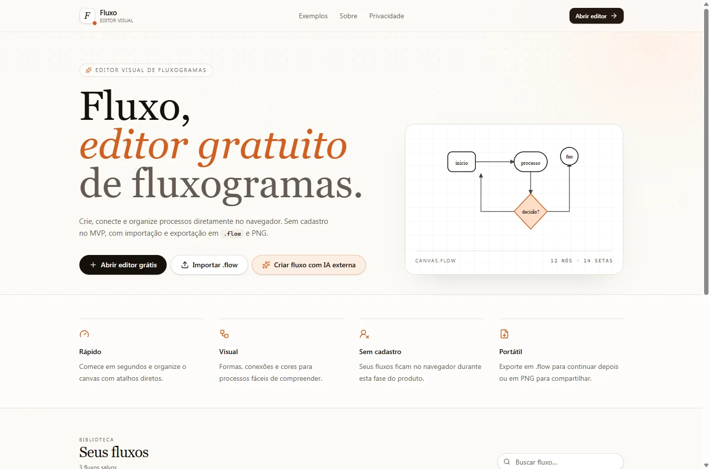

# Fluxo

Editor visual de fluxogramas para criar, conectar, organizar e exportar processos no navegador.

[Usar o aplicativo](https://fluxo-nine-theta.vercel.app/) · [Guia técnico](docs/TECHNICAL_GUIDE.md) · [Deploy](docs/DEPLOY.md)

## Visão geral

O Fluxo transforma ideias e processos em diagramas editáveis. O MVP funciona sem cadastro, mantém os projetos no navegador e permite transportar o trabalho por arquivos `.flow`.

## Funcionalidades

- Canvas com zoom, grid, snap e minimapa.
- Blocos SVG com diferentes formas, cores e dimensões.
- Conexões direcionais e bidirecionais, com roteamento em torno dos blocos.
- Organização automática, atalhos contextuais e desfazer/refazer.
- Modo apresentação e exportação para PNG.
- Importação e exportação de projetos em `.flow`.

## Decisões técnicas

| Decisão | Objetivo |
|---|---|
| Armazenamento local | Permitir uso imediato sem conta ou servidor de dados. |
| Geometria das formas | Posicionar as conexões sobre a borda real de cada bloco. |
| Roteamento de conexões | Organizar caminhos e reduzir sobreposições visuais. |
| Formato portátil | Separar o projeto editável da imagem exportada. |

**Stack:** React, TypeScript, TanStack Start/Router, XYFlow, Vite, Tailwind CSS e Nitro.

## Executar localmente

Com Node.js e npm instalados:

~~~bash
npm ci
npm run dev
~~~

Para verificar e visualizar o build:

~~~bash
npm run lint
npm run build
npm run preview
~~~

O pacote atual não possui script de testes automatizados. `npm run format` altera arquivos e fica reservado à formatação intencional.

## Como avaliar

Crie um fluxo descartável, conecte formas diferentes, mova os blocos e confira o roteamento. Depois teste desfazer/refazer, exporte o projeto e reimporte a cópia em outro perfil do navegador.

## Estado e limites

MVP publicado. A persistência é local: sincronização em nuvem e colaboração em tempo real não fazem parte desta versão. Exporte uma cópia para manter os fluxos fora do dispositivo.

## Documentação

- [Rotas, atalhos, estrutura e histórico de desenvolvimento](docs/TECHNICAL_GUIDE.md).
- [Publicação](docs/DEPLOY.md) e [checklist de produção](docs/PRODUCTION_CHECKLIST.md).

A licença ainda não está definida no repositório.
